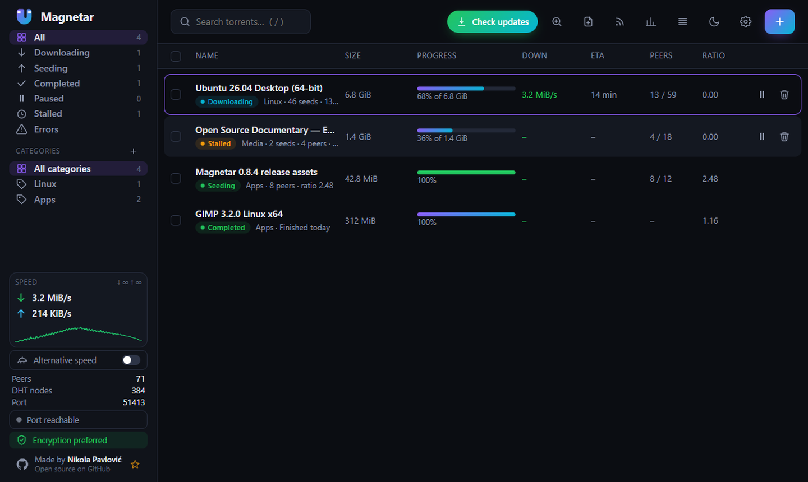
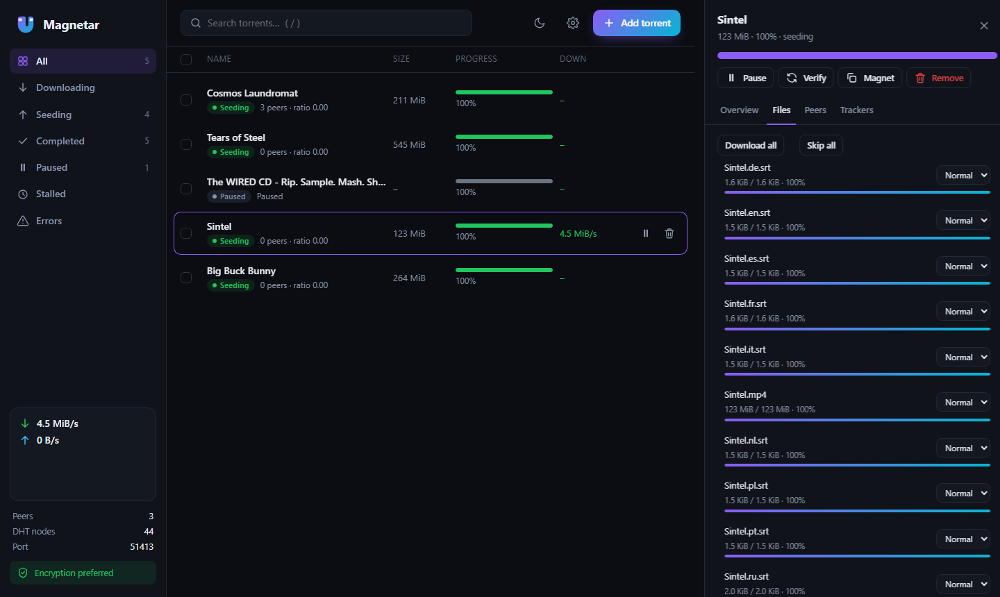
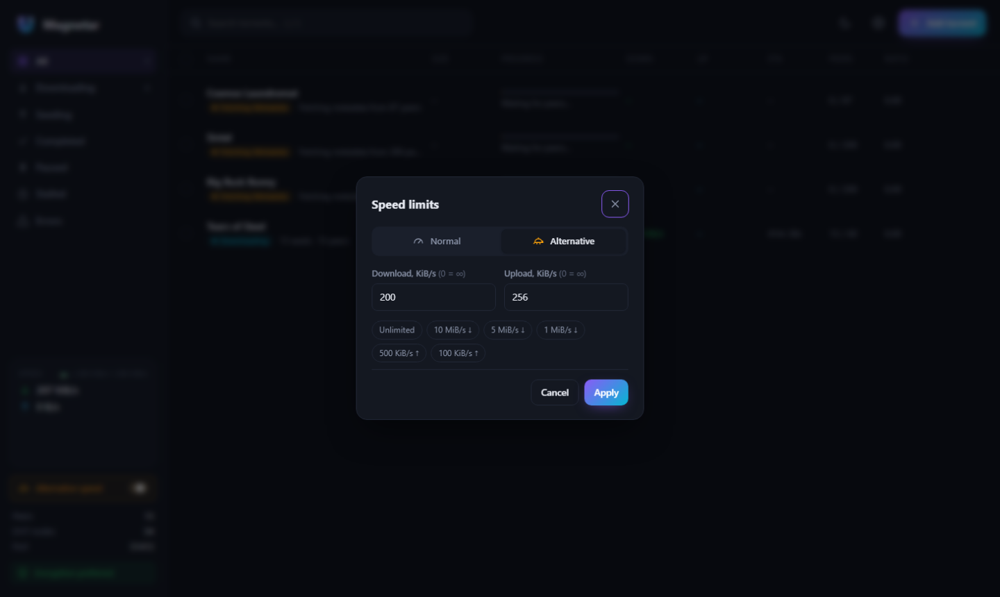

<div align="center">


# Magnetar

**A fast, secure, open-source BitTorrent client with a modern interface.**

Windows installer · Ubuntu/Debian package · No ads · No telemetry

[](https://github.com/nikolap994/magnetar/actions/workflows/ci.yml)
[](https://github.com/nikolap994/magnetar/actions/workflows/codeql.yml)
[](https://github.com/nikolap994/magnetar/releases/latest)
[](https://goreportcard.com/report/github.com/nikolap994/magnetar)
[](LICENSE)



</div>

---

## Features

**A real desktop client**
- Native installers: **Windows setup `.exe`** and **Ubuntu/Debian `.deb`** (plus portable builds)
- Opens in its own app window with a **tray icon** (open, pause/resume all, turtle mode, quit)
- **Click a magnet link in any browser** → Magnetar asks where to save it, just like qBittorrent
- Opens `.torrent` files from your file manager; optional start at sign-in
- **Updates itself**: one click installs new releases, verified with Magnetar's signing key before anything runs

**Everything you expect from a torrent client**
- Magnet links, `.torrent` files and bare info hashes - paste anywhere, drag & drop, or click in the browser
- **Choose the download folder** per torrent with a built-in folder browser, plus a default folder
- **Resumes like qBittorrent**: remove a torrent but keep its files, add it again later and Magnetar checks what is
  already on disk and downloads only what is missing
- **Speed limits like qBittorrent**: global download/upload limits plus *alternative* (turtle) limits you can toggle
  with one click from the sidebar or tray
- Pause, resume, verify, remove (with or without data), bulk actions and right-click menus
- Per-file selection and priorities (skip / normal / high), sequential download for previewing video
- Live speeds, ETA, ratio, peers, trackers and a piece map; seed-ratio limit
- DHT, PEX, local peer discovery, µTP, UPnP/NAT-PMP, web seeds, BitTorrent v2 hybrid torrents

**Built for speed**
- Powered by the battle-tested [`anacrolix/torrent`](https://github.com/anacrolix/torrent) engine
- Tuned connection limits, parallel piece hashing and memory-mapped file storage
- Fully static Go binary (~22 MB), starts in milliseconds, no runtime to install

**Secure by default** - see [Security model](#security-model)
- Protocol encryption (MSE/PE) preferred, or **required** with one switch
- Bind all peer, tracker and DHT traffic to one IP (e.g. your VPN) - traffic **stops** if the VPN drops
- IP blocklists (P2P/eMule format, `.gz` supported) and anonymous mode
- Interface listens on `127.0.0.1` only, with signed sessions, CSRF and DNS-rebinding protection, a strict CSP and an
  isolated browser profile for the app window

<p align="center">
  
  
</p>

## Install

Download from the [latest release](https://github.com/nikolap994/magnetar/releases/latest).

### Windows 10 / 11
1. Run **`magnetar_<version>_windows_amd64_setup.exe`** (`arm64` for ARM PCs). No administrator rights needed -
   Magnetar installs for your account in `%LOCALAPPDATA%\Programs\Magnetar`.
2. Choose **Yes** to use Magnetar for magnet links and `.torrent` files.
3. Start Magnetar from the Start Menu or desktop. It lives in the tray (bottom-right).

> **First magnet click:** Windows protects your default apps, so the first time you click a magnet link it may ask
> *"How do you want to open this?"* - pick **Magnetar** and tick **Always**. You can also set it in
> **Settings → Apps → Default apps → Magnetar**.

Uninstall from **Settings → Apps → Installed apps → Magnetar**. Your downloads and settings are kept.
A portable `.zip` is also available (run `magnetar.exe register` once to handle magnet links).

> Until the project's Authenticode certificate is in place (see [docs/SIGNING.md](docs/SIGNING.md)), SmartScreen may
> show *"Windows protected your PC"*. Verify the download (see below), then click **More info → Run anyway**.

### Ubuntu / Debian / Linux Mint / Pop!_OS
```sh
sudo apt install ./magnetar_<version>_amd64.deb
magnetar register     # once: make Magnetar the default for magnet links in your browser
```
Then start **Magnetar** from your applications menu. For the app-window experience install Chromium, Chrome or Edge;
otherwise Magnetar opens in your default browser. The tray icon needs a desktop with StatusNotifier support
(KDE, Cinnamon, XFCE, or GNOME with the *AppIndicator* extension).

### Other Linux (portable)
```sh
tar xzf magnetar_<version>_linux_amd64.tar.gz && cd magnetar_<version>_linux_amd64
./install.sh            # installs to ~/.local/bin and registers magnet/.torrent handling
./install.sh --service  # optional: run headless at login as a systemd user service
```

### From source
Requires Go 1.26+.
```sh
git clone https://github.com/nikolap994/magnetar.git
cd magnetar
make build      # → bin/magnetar for this machine
make release    # → dist/: Windows setup + zip, .deb, .tar.gz for amd64 and arm64, SHA256SUMS
```

### Verify your download
Every release is built in GitHub Actions, signed with [Sigstore](https://www.sigstore.dev/) and carries a
[build-provenance attestation](https://docs.github.com/actions/security-guides/using-artifact-attestations), so you can prove a binary was built from this repository:

```sh
gh attestation verify magnetar_<version>_linux_amd64.tar.gz --repo nikolap994/magnetar
```

See [docs/SIGNING.md](docs/SIGNING.md) for cosign and checksum verification.

## Usage

```text
magnetar [flags] [magnet-link | file.torrent ...]

  magnetar passwd       set or change the web UI password
  magnetar register     open magnet links and .torrent files with Magnetar
  magnetar unregister   remove those file associations

Flags:
  --dir <path>    config/data directory (default: OS user config dir)
  --port <n>      override web UI port (default 8899)
  --no-browser    do not open the browser on start
  --headless      server/NAS mode: no window, no tray icon
  --verbose       debug logging
  --version       print version
```

Magnetar's interface is a local web app shown in its own window. On launch it signs that window in with a **one-time
link**, so no password is needed on your own computer. To use it from another device (e.g. on a home server), set a password first and then change the listen address
in **Settings → Web interface**.

### Updates

Magnetar checks GitHub Releases once a day and shows **Update to x.y.z** in the toolbar when a new version is out.
Click it to read the release notes and **Install & restart** - the download is verified against Magnetar's signing
key and checksum before it is installed, and transfers resume after the restart. Turn automatic checks off in
**Settings → About**. (Versions before 0.2.0 must be updated manually once.)

### Keyboard shortcuts

| Key | Action |
| --- | --- |
| <kbd>N</kbd> | Add torrent |
| <kbd>/</kbd> | Search |
| <kbd>↑</kbd> <kbd>↓</kbd> | Move between torrents |
| <kbd>Space</kbd> | Pause / resume |
| <kbd>Delete</kbd> | Remove |
| <kbd>Ctrl</kbd>+<kbd>A</kbd> | Select all |
| <kbd>Esc</kbd> | Clear selection / close panel |
| <kbd>Ctrl</kbd>+<kbd>V</kbd> | Paste a magnet link anywhere |

Click the **speed card** in the sidebar to change limits, or the **turtle** switch to toggle alternative limits.

### Where things are stored

| | Linux | Windows |
| --- | --- | --- |
| Settings & keys | `~/.config/magnetar/` | `%AppData%\magnetar\` |
| Session, logs, piece database | `~/.local/share/magnetar/` | `%AppData%\magnetar\` |
| Downloads (default) | `~/Downloads/Magnetar` | `%UserProfile%\Downloads\Magnetar` |

## Security model

Magnetar is designed so that running it does not widen your attack surface.

| Threat | Mitigation |
| --- | --- |
| Other websites driving the UI (CSRF) | `SameSite=Strict` cookies, mandatory custom request header, `Origin` checks |
| DNS rebinding | `Host` header allow-list (loopback by default) |
| XSS via malicious torrent names | UI renders all torrent data with `textContent`; strict CSP with no inline scripts or styles; no third-party JS |
| Clickjacking | `frame-ancestors 'none'`, `X-Frame-Options: DENY` |
| Remote access without auth | UI binds to `127.0.0.1`; Magnetar refuses to listen on a network address without a password |
| Password brute force | Argon2id hashing, rate-limited logins |
| Path traversal in torrents | File paths are confined to the download folder; symlinks out of it are rejected; "delete data" never leaves the save path or removes files shared with another torrent |
| Metadata leaks | Magnet `xs`/`as` sources (arbitrary HTTP fetches) are ignored; optional anonymous mode hides client identity |
| VPN drops | Binding to an IP makes sockets fail rather than fall back to another interface |
| Browser extensions reading the UI | The app window uses its own isolated browser profile with extensions disabled |
| Tampered downloads of Magnetar | Reproducible builds, Sigstore signatures and build-provenance attestations |
| Malicious updates | Updates install only if `SHA256SUMS` carries a valid Ed25519 signature from the release key and the file's hash matches; HTTPS from GitHub hosts only |
| Secrets on disk | Settings, keys and session files are written atomically with `0600` permissions |

Found a vulnerability? Please follow [SECURITY.md](SECURITY.md).

## Architecture

```text
cmd/magnetar          entry point, single-instance handoff, magnet/.torrent registration
cmd/magnetar-setup    Windows installer/uninstaller (embeds magnetar.exe, no admin rights)
internal/engine       torrent lifecycle, resume/verify, persistence, speed limits, sequential mode
internal/server       hardened HTTP API, folder browser, Server-Sent Events for live updates
internal/desktop      app window, tray icon, autostart
internal/update       signed self-updater (GitHub Releases)
internal/fsutil       validation of user- and torrent-supplied paths
internal/auth         signed sessions, one-time launch tokens, Argon2id
internal/config       validated settings, atomic writes
web/static            dependency-free UI (HTML/CSS/JS), embedded in the binary
packaging/linux       .deb builder, desktop entry, AppStream metadata, icons
```

The UI talks to a small JSON API (`/api/torrents`, `/api/actions`, `/api/settings`, `/api/events`), so scripts and
other front-ends can drive Magnetar too.

## Contributing

Contributions are welcome! Read [CONTRIBUTING.md](CONTRIBUTING.md) to get started. Please only use Magnetar to share
content you have the right to share.

## License

[MIT](LICENSE) © Nikola Pavlović and contributors.
Magnetar builds on [anacrolix/torrent](https://github.com/anacrolix/torrent) (MPL-2.0).
